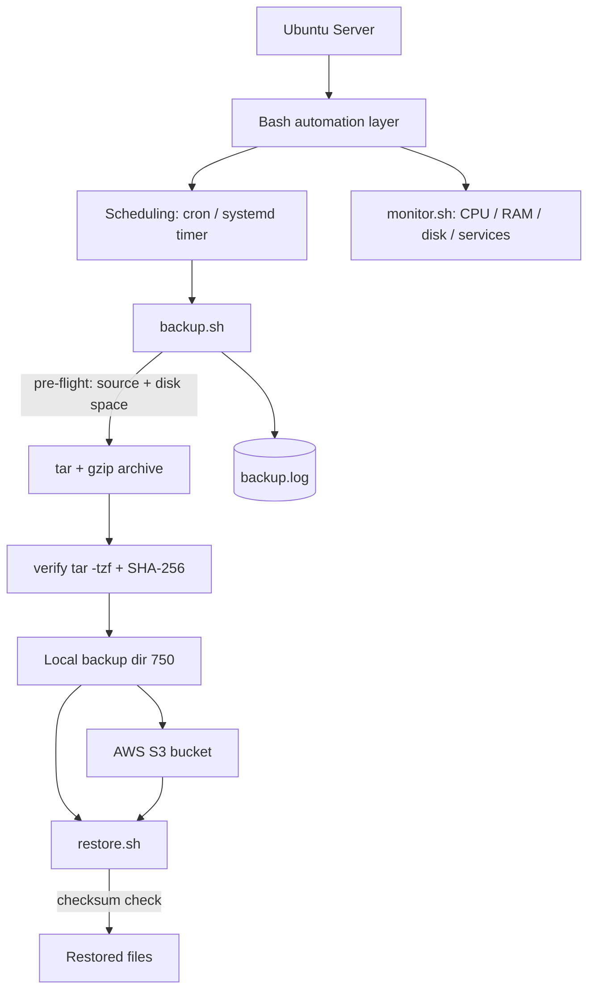

# Architecture

## Layers
1. **Linux server**: users, groups, permissions, services (`setup_users.sh`).
2. **Automation**: Bash scripts sharing `lib.sh` (config loading and logging).
3. **Scheduling**: cron (`install.sh cron`) or systemd timer (`install.sh systemd`).
4. **Storage**: local archives plus optional S3 copy.
5. **Monitoring and recovery**: logs, `verify_backup.sh`, `restore.sh`.

## Key design decisions
| Decision | Reason |
|---|---|
| Config in `backup.conf`, not in scripts | Change behavior without editing code |
| `flock` lock | Prevents overlapping backups corrupting each other |
| Checksum + archive test | Detects silent corruption before it matters |
| Retention after success only, keep newest 3 | A failing backup job can never wipe all good backups |
| Local copy kept if S3 fails | Cloud outage does not lose the backup |
| IAM policy limited to one prefix | Least privilege if credentials leak |
| Archive paths stored relative to `/` | Restore recreates the original path layout under the restore directory |
